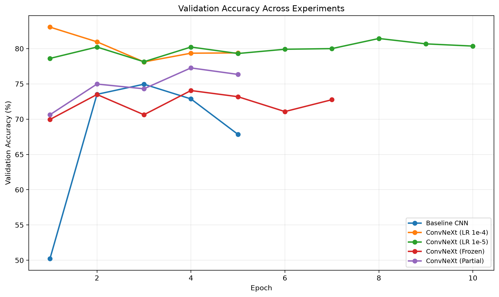
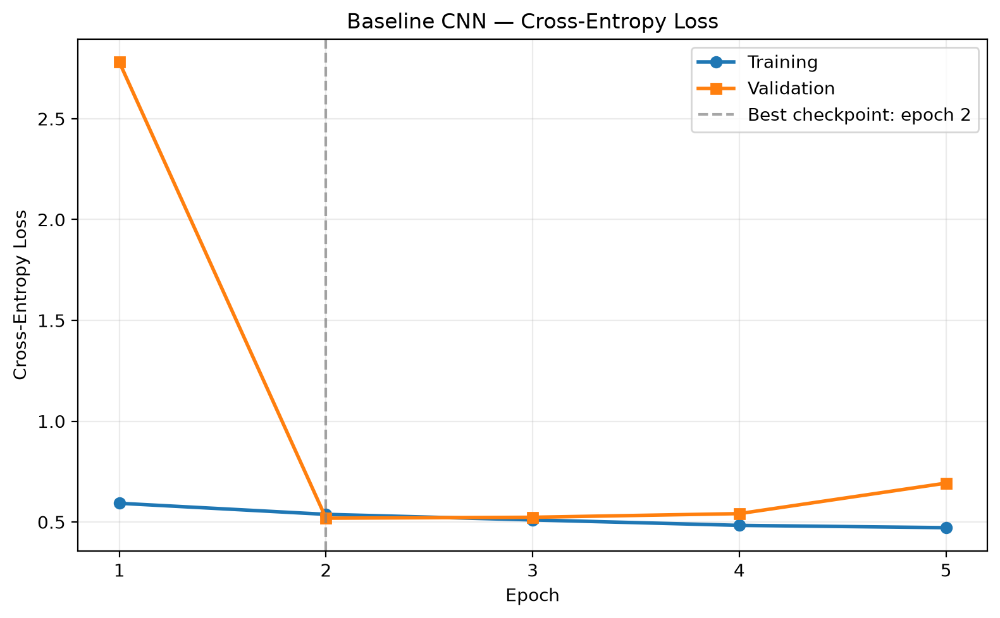
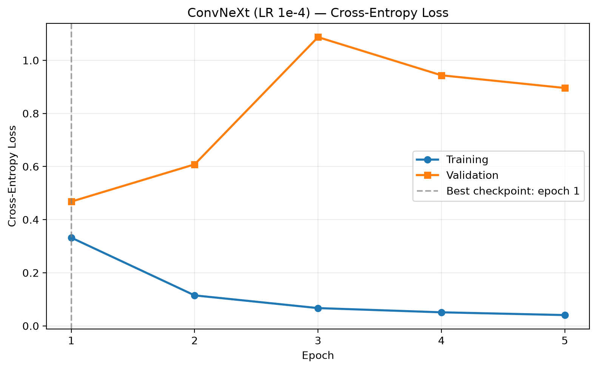
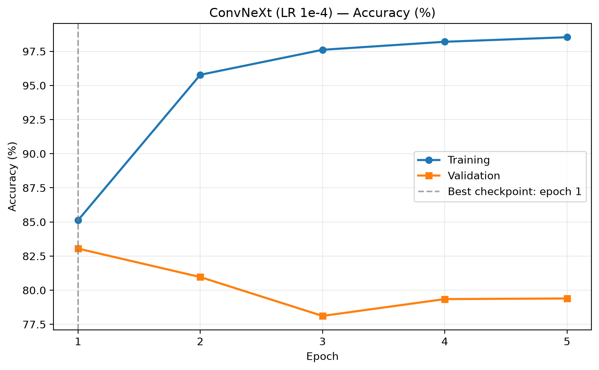
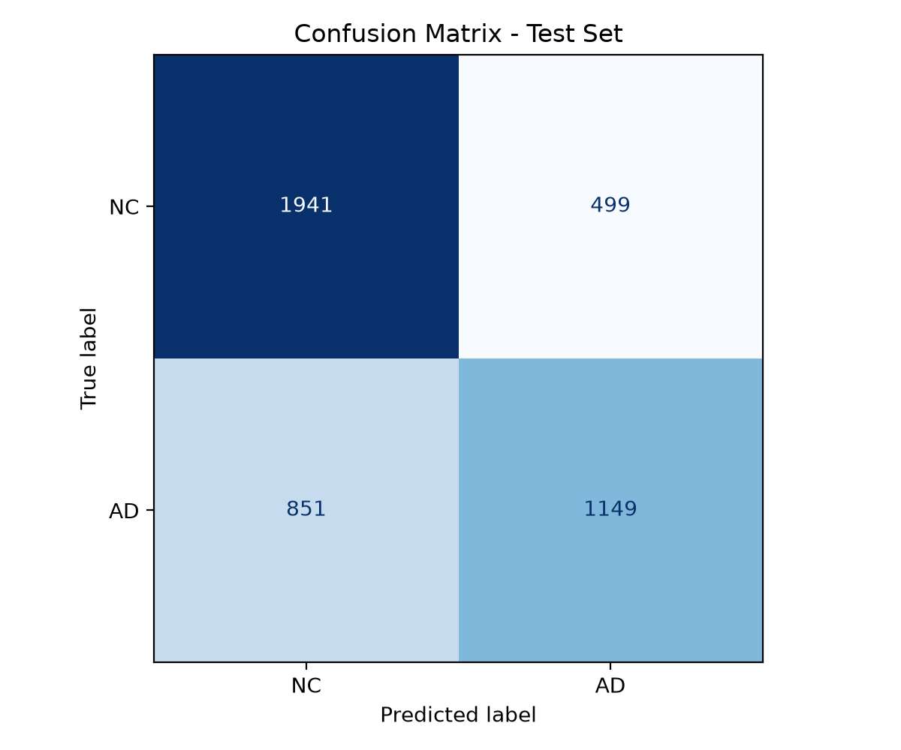
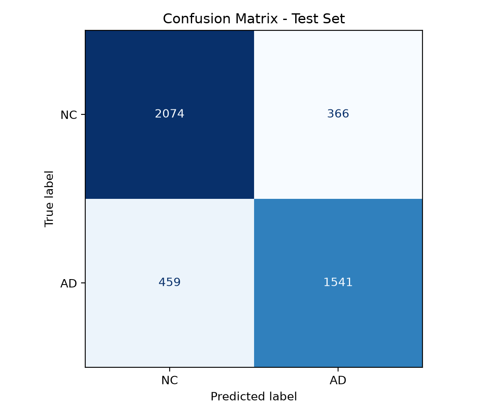
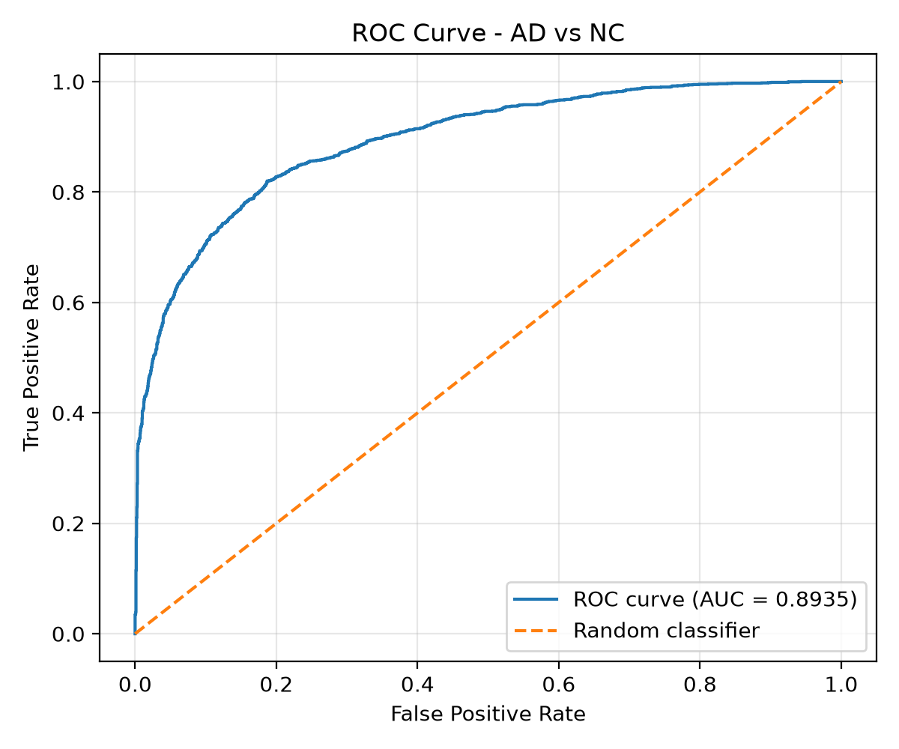
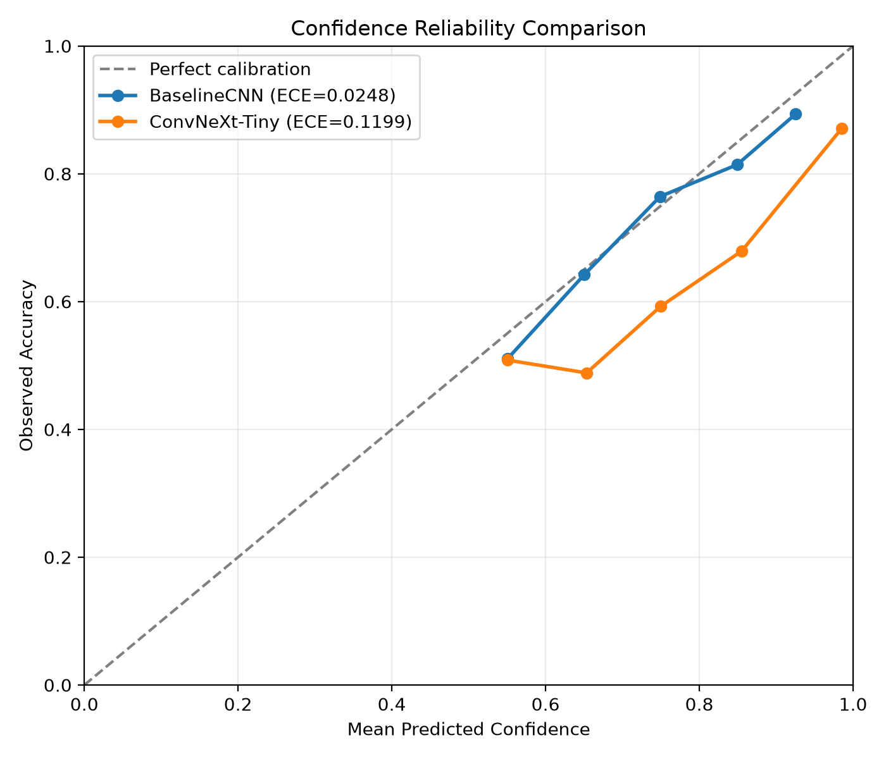
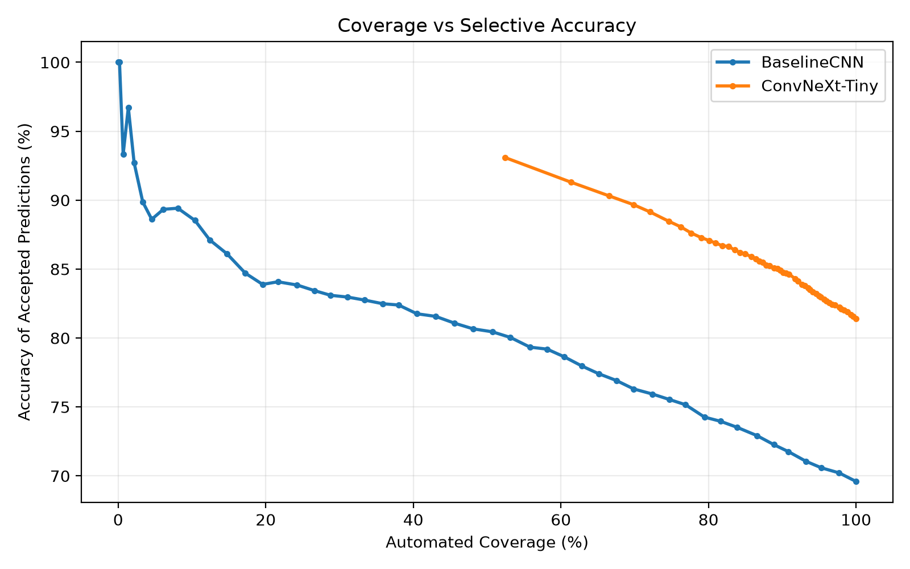

# Alzheimer's Disease Classification from MRI Slices Using ConvNeXt-Tiny

**COMP3710 Pattern Recognition · University of Queensland**  
**Student ID:** s4984777 · **Difficulty:** Hard · **Framework:** PyTorch  
**Dataset:** ADNI brain MRI (course-provided, Rangpur) · **Task:** AD (1) vs Cognitively Normal / NC (0)

> **Research prototype, not a medical device.** The model predicts labels for individual 2D MRI slices. Its outputs are not patient diagnoses, and softmax confidence should not be interpreted as clinical certainty.

## 1. Project overview and engineering question

This project studies binary classification of preprocessed structural brain MRI slices into **Alzheimer's Disease (AD)** and **Cognitively Normal (NC)** categories. The intended context is a research or clinical-imaging workflow in which a machine-learning assistant might prioritize cases for specialist review, not independently diagnose patients. A four-block convolutional neural network (CNN) provides a simple baseline; the proposed hard-difficulty system replaces it with **ImageNet-pretrained ConvNeXt-Tiny**, adapted to a two-class output head. Models are compared on an identical, patient-independent test split.

**Engineering dilemma:** Does ConvNeXt improve not only classification accuracy but also the *reliability of predicted confidence* relative to a simple CNN? When errors can be made with high confidence, can a confidence-based reject/referral rule provide a defensible balance between automated coverage, missed AD slices, and clinical review effort?

**Main findings.** ConvNeXt-Tiny attained **81.42% slice-level test accuracy** on 4,440 held-out images versus **69.59%** for BaselineCNN, meeting the assignment's 80% target. However, ConvNeXt had **worse ten-bin expected calibration error** (ECE **0.1199** vs **0.0248**) and made high-confidence false negative and false positive predictions. A 90%-confidence acceptance rule retained **80.11%** of test slices at **87.07% accepted-case accuracy**, but still accepted **279 AD→NC errors**. These findings favor a research-stage, human-in-the-loop prototype rather than autonomous clinical use.



*Figure 1. Validation accuracy across the experiments. Experimental checkpoints were selected by minimum validation loss, not by test performance.*

## 2. One-page feasibility review (midpoint submission)

*The following section preserves the substance and preliminary status of the one-page feasibility review presented for the COMP3710 project. Its initial statements about training being pending refer to the midpoint, not the completed project.*

### 2.1 User need, scope, and acceptance criteria

The prototype classifies structural brain MRI images into AD or NC. Its intended users are clinical researchers and medical imaging specialists who may benefit from automated screening assistance; it is intended to **support, not replace**, clinical decisions. The central challenge is whether ConvNeXt-Tiny provides more reliable classification and confidence estimates than a conventional CNN, particularly for ambiguous or misclassified images.

The proposed acceptance criteria were: (1) achieve at least **80% held-out test accuracy**; (2) ensure **zero patient overlap** across train, validation, and test sets; (3) compare accuracy, per-class precision/recall, macro-F1, AUROC, and confidence reliability with a baseline; (4) analyze **3–5 representative errors** and a confidence-based referral rule; and (5) measure model parameters, peak GPU memory, and inference latency.

### 2.2 Model choice and course concepts

The project uses the course-provided ADNI brain MRI dataset on Rangpur. A simple CNN serves as the baseline; **ConvNeXt-Tiny** is the proposed Hard-difficulty model. ConvNeXt modernizes convolutional image classification with depthwise convolutions, residual connections, and hierarchical feature extraction. The implementation uses PyTorch and ImageNet-pretrained weights as an initialization option. Both models are evaluated with the same patient-independent splits.

### 2.3 Preliminary feasibility evidence

At the midpoint, the dataset audit identified **30,520 JPEG slices from 680 distinct patients**. An initial inspection of the supplied folder division revealed **216 patients overlapping** between the original train/test directories, creating potential leakage if used as-is. A stratified **patient-level** split with random seed **42** was implemented, yielding 476/102/102 patients and 21,620/4,460/4,440 slices for train/validation/test, respectively. No patient was assigned to more than one split. The PyTorch loader produced batches of shape **(8, 3, 224, 224)**. At the review stage, final training and benchmarking had not yet been completed.

### 2.4 Risks, compute budget, and fallback

Risks identified at feasibility review included overfitting to patient-specific anatomy, unreliable confidence estimates, the gap between 2D slice accuracy and patient-level diagnosis, and ConvNeXt's higher computational cost. The plan was to test CUDA and data loading using a short A100 allocation on Rangpur, then train the baseline and ConvNeXt through Slurm jobs. The baseline CNN would remain a fallback if ConvNeXt proved computationally impractical. The preliminary conclusion supported continuing, subject to measured accuracy, calibration, and efficiency.

**Post-feasibility outcome:** Training and testing were completed; the 80% slice-level accuracy target was reached, while confidence calibration and AD false negatives remained substantial concerns.

## 3. Dataset, preprocessing, and leakage controls

The course provides preprocessed ADNI structural MRI slices as JPEG files under `/home/groups/comp3710/ADNI/AD_NC` on Rangpur. We use **NC = 0** and **AD = 1**. Each patient contributes multiple slices; consequently, randomly splitting individual slices would contaminate evaluation with correlated images from patients already seen during training.

| Split | Patients | MRI slices | NC slices | AD slices |
|---|---:|---:|---:|---:|
| Train | 476 | 21,620 | 11,000 | 10,620 |
| Validation | 102 | 4,460 | 2,220 | 2,240 |
| Test | 102 | 4,440 | 2,440 | 2,000 |
| **Total** | **680** | **30,520** | **15,660** | **14,860** |

The program uses **patient-stratified splitting**, with seed **42** and **no patient-ID overlap** across these partitions. The original on-disk folder name (`train/` or `test/`) does **not** determine the final split: the generated `splits.csv` manifest does. This explains why a held-out test sample may have a physical filename beneath the dataset's original `train/` directory.

At inference, images are loaded, converted to three-channel RGB, resized to **224 × 224**, converted to tensors, and normalized using ImageNet means `(0.485, 0.456, 0.406)` and standard deviations `(0.229, 0.224, 0.225)`. The model consumes tensors shaped `(batch, 3, 224, 224)`. **[VERIFY FROM `dataset.py`: document the exact train-time augmentation, if any; note whether any orientation-changing transforms were avoided.]** Validation/test transformations must remain deterministic.

**Important limitations:** The 30,520 slices are not 30,520 statistically independent patients. Test metrics here are **slice-level**; they cannot be interpreted as patient-level diagnostic sensitivity or clinical accuracy. Data permission restrictions also apply to sharing medical images and patient-identifying manifests.

## 4. Models and working principles

### 4.1 BaselineCNN

The implemented baseline uses four repeated feature-extraction blocks: **3×3 convolution → batch normalization → ReLU → 2×2 max pooling**, with channels **3 → 32 → 64 → 128 → 256**. An adaptive global average pool reduces the representation to a 256-dimensional vector; dropout (0.3) and a fully connected layer produce **two logits** (NC and AD). Its relatively small size (**389,890 parameters**) provides a low-cost reference model.

### 4.2 ConvNeXt-Tiny

The advanced model uses `torchvision.models.convnext_tiny` with pretrained ImageNet weights and replaces the final 768-dimensional classifier with a **768 → 2** linear layer. ConvNeXt-Tiny extracts multiscale visual features through convolutional stages incorporating depthwise spatial mixing and residual connections. Its **27,821,666 parameters** provide substantially greater representational capacity, at higher storage and compute cost. Both models produce logits; softmax converts these to an NC/AD score distribution during inference. Training minimizes **cross-entropy loss** with AdamW optimization.

Transfer learning is an important difference between the models: the ConvNeXt result reflects the effects of **both** architecture and ImageNet pretraining, rather than a controlled architecture-only comparison.

### 4.3 Training variants

The investigation compared a baseline CNN against ConvNeXt with (a) full fine-tuning at two learning rates, (b) training only the final classifier head (frozen backbone), and (c) partial fine-tuning of the later ConvNeXt stage plus classifier. The training code and job configurations document the exact modes. The first attempt at partial fine-tuning unintentionally left the whole network trainable; the corrected run should be distinguished from that invalid configuration in any discussion of ablation results.

## 5. Implementation and reproducibility

### 5.1 Directory layout

```text
recognition/convnext_adni_s4984777/
├── README.md
├── modules.py            # Model architectures
├── dataset.py            # Dataset audit, split, loading, transforms
├── train.py              # Model training and checkpoint saving
├── predict.py            # Single-image inference and visualization
├── evaluate.py           # Held-out test evaluation
├── plot_train.py         # Training history figures
├── conf.py               # Confidence, calibration, and referral analysis
├── error.py              # Representative error selection/plots
├── baseline.sbatch
├── train.sbatch
├── exp2.sbatch
├── exp3.sbatch
├── exp4.sbatch
├── eval.sbatch
├── predict.sbatch
└── figures/              # Reviewed plots included in this README
```

`checkpoints/`, `results/`, Rangpur job logs, and the original ADNI files are **local/generated artifacts** and are not intended to be committed. Do not commit model weights, raw MRI images, or identifiable patient-level manifests to the public repository.

### 5.2 Environment and dependencies

Experiments were run on UQ's **Rangpur** HPC GPU resources, using an **NVIDIA A100** allocated via Slurm. Python and the main libraries include `torch`, `torchvision`, `numpy`, `pandas`, `Pillow`, `scikit-learn`, and `matplotlib`.

**[REQUIRED BEFORE SUBMISSION]** Replace this paragraph with the *actual exact versions* from the working environment and add a tested `requirements.txt`. Run, for example:

```bash
python --version
python -c "import torch, torchvision, numpy, pandas, sklearn, matplotlib, PIL; print('torch',torch.__version__,'torchvision',torchvision.__version__,'numpy',numpy.__version__,'pandas',pandas.__version__,'sklearn',sklearn.__version__,'matplotlib',matplotlib.__version__,'Pillow',PIL.__version__)"
```

### 5.3 Reproduction commands

Run these commands **inside** the `recognition/convnext_adni_s4984777` directory. Access to course-provided ADNI data on Rangpur is required. Generate or check the patient-level manifest using the dataset script's documented interface **[VERIFY EXACT COMMAND WITH `python dataset.py --help` OR ITS MAIN BLOCK]**. Do not assume the supplied original train/test folders are patient-independent.

A simple model smoke check is:

```bash
python -m py_compile modules.py dataset.py train.py predict.py evaluate.py
```

Training example (GPU Slurm allocation required):

```bash
# From a GPU allocation, or via the appropriate .sbatch file:
python train.py --model baseline --epochs 5 --batch-size 8 --require-cuda
python train.py --model convnext --epochs 5 --batch-size 8 --lr 1e-4 --require-cuda
```

For the recorded experiments, use the committed `baseline.sbatch`, `train.sbatch`, `exp2.sbatch`, `exp3.sbatch`, and **corrected** `exp4.sbatch` configurations. Checkpoint selection used the **minimum validation loss**, and the held-out test split was not used for training/selection. Saved checkpoints reside locally in `checkpoints/<run>/<model>/best.pth` or `checkpoints/<model>/best.pth`, depending on the run.

Final evaluation (requires a trained local checkpoint):

```bash
sbatch eval.sbatch
# Or within a suitable GPU allocation:
python evaluate.py --model convnext --checkpoint checkpoints/convnext/best.pth \
  --output-dir results/convnext --batch-size 8 --require-cuda
```

Prediction example:

```bash
python predict.py --model convnext --checkpoint checkpoints/convnext/best.pth \
  --test-index 0 --output results/prediction_convnext.png
```

**Recorded example output:** for a test image labeled AD, the model predicted **NC 78.53%**, **AD 21.47%**, hence an incorrect NC classification. `predict.py` prints the class probabilities and saves a side-by-side visualization. The example's index refers to the final split manifest; it is not necessarily the first image in a source folder.

Reproduce report plots using:

```bash
python plot_train.py
python conf.py
python error.py
```

The analytical scripts read local training histories, prediction CSVs, and the split manifest; they do not retrain the models. **[VERIFY ALL COMMANDS AND CHECKPOINT PATHS AGAINST THE FINAL GIT COMMIT.]**

## 6. Training experiments and model selection

The baseline and ConvNeXt were evaluated under matching patient-independent data partitions. The original ConvNeXt used full fine-tuning and learning rate **1×10⁻⁴**. A second full-fine-tuning experiment used **1×10⁻⁵**; the later experiments tested a fully frozen feature backbone and partial fine-tuning. A fixed architecture and data split permit examination of optimization and adaptation trade-offs, although some other settings differ by experiment.

| Run | Configuration | Selected epoch (minimum val. loss) | Validation accuracy at selected epoch | Main observation |
|---|---|---:|---:|---|
| Baseline | Four-block CNN, 5 epochs | 2 | 73.52% | Lower-capacity comparison |
| ConvNeXt 1 | Full fine-tune, LR 1e-4, 5 epochs | 1 | **83.05%** | Best validation-loss checkpoint |
| ConvNeXt 2 | Full fine-tune, LR 1e-5, up to 10 epochs | 2 | 80.22% | Lower LR did not outperform Experiment 1 |
| ConvNeXt 3 | Frozen pretrained backbone, head training | 4 | 74.06% | Representation adaptation was too restricted |
| ConvNeXt 4 | Corrected partial fine-tuning, LR 1e-5 | 2 | 74.98% | Later-stage-only fine-tuning did not outperform full fine-tuning |

**[VERIFY ABOVE EXPERIMENT SUMMARY AGAINST YOUR GENERATED `experiment_summary.csv`.]** The corrected partial run reached a higher *intermediate* validation accuracy in a later epoch, but its selected checkpoint corresponds to the **lowest validation loss**, not the maximum validation accuracy. Do not confuse these measures.



*Figure 2. Baseline training/validation loss.*



*Figure 3. Original ConvNeXt training/validation loss; the minimum-validation-loss checkpoint was at epoch 1.*



*Figure 4. Accuracy progression during full fine-tuning.*

The original ConvNeXt training accuracy rose to very high values while validation loss deteriorated after the first epoch. This **generalization gap** is consistent with overfitting. The model selected for final testing was therefore `checkpoints/convnext/best.pth` from epoch 1, *not* the final-epoch checkpoint.

## 7. Held-out test benchmark

Both selected checkpoints were evaluated once on the same **4,440 test MRI slices** (2,440 NC; 2,000 AD).

| Metric | BaselineCNN | ConvNeXt-Tiny |
|---|---:|---:|
| Test accuracy | 69.59% | **81.42%** |
| Macro-F1 | 0.6860 | **0.8115** |
| ROC-AUC | 0.7675 | **0.8935** |
| NC precision | 69.52% | **81.88%** |
| NC recall | 79.55% | **85.00%** |
| NC F1 | 0.7420 | **0.8341** |
| AD precision | 69.72% | **80.81%** |
| AD recall | 57.45% | **77.05%** |
| AD F1 | 0.6299 | **0.7888** |
| Correctly classified slices | 3,090 | **3,615** |
| Incorrectly classified slices | 1,350 | **825** |

**Accuracy improvement:** **11.82 percentage points**, or 525 additional correctly classified slices. The improvement is not uniform across diagnostic risks: AD recall increased from 57.45% to 77.05%, but ConvNeXt still missed **459 of 2,000 AD-labeled slices**.

### 7.1 Confusion matrices

| Model | True NC → NC | True NC → AD (FP) | True AD → NC (FN) | True AD → AD |
|---|---:|---:|---:|---:|
| BaselineCNN | 1,941 | 499 | 851 | 1,149 |
| ConvNeXt-Tiny | 2,074 | 366 | 459 | 1,541 |



*Figure 5. BaselineCNN confusion matrix.*



*Figure 6. ConvNeXt-Tiny confusion matrix.*

### 7.2 ROC-AUC



*Figure 7. ConvNeXt ROC curve. AUROC measures ranking/discrimination across thresholds, not the calibration of predicted probabilities.*

### 7.3 Resource trade-offs

| Resource metric | BaselineCNN | ConvNeXt-Tiny |
|---|---:|---:|
| Parameters | 389,890 | 27,821,666 |
| Inference forward-pass latency | 0.425 ms/slice | 1.181 ms/slice |
| Inference throughput | 2,355 slices/s | 846 slices/s |
| Peak allocated GPU memory during evaluation | 0.112 GiB | 0.207 GiB |

These latency measures were recorded on the A100 using **batch size 8** and synchronized forward passes. They exclude image decoding, loading, and most preprocessing, so they are **not end-to-end clinical workflow latency**. Inference GPU allocation is not directly comparable with peak memory during training. ConvNeXt uses approximately 71× the parameters and 2.8× the measured forward-pass time per image, but also improves classification substantially.

## 8. Confidence calibration and selective referral

A classifier can discriminate well while remaining poorly calibrated: a prediction assigned 95% confidence need not be correct 95% of the time. We therefore examine **top-class confidence calibration**, probability scoring, and the trade-off between accepted predictions and referral for specialist review.

| Metric | BaselineCNN | ConvNeXt-Tiny |
|---|---:|---:|
| 10-bin ECE (lower is better) | **0.0248** | 0.1199 |
| Brier score for AD probability (lower is better) | 0.1966 | **0.1494** |
| Log loss (lower is better) | **0.5787** | 0.5812 |
| Mean confidence on correct predictions | 73.50% | 95.25% |
| Mean confidence on incorrect predictions | 66.33% | 85.35% |

ConvNeXt has markedly **higher accuracy and lower Brier score**, yet **higher ECE** under the adopted ten-bin computation. These are not inconsistent: Brier score combines discrimination and calibration effects, whereas ECE approximates reliability using discretized confidence bins. ECE changes with binning and sample composition; it should not be treated as a definitive proof of calibration quality. ConvNeXt's average confidence on **incorrect** predictions (85.35%) indicates an important operational risk.



*Figure 8. Predicted confidence compared with empirical accuracy. The deviation from the diagonal illustrates confidence miscalibration.*

### 8.1 Referral threshold illustration

A simple selective-classification rule accepts the model's predicted label only when the **maximum softmax probability** is at least threshold *t*; otherwise it refers the slice for human review. The figures below evaluate this rule retrospectively on the existing held-out test predictions.

| ConvNeXt threshold | Automated coverage | Referral rate | Accuracy among accepted | Accepted errors | Accepted AD→NC errors |
|---|---:|---:|---:|---:|---:|
| 50% | 100.00% | 0.00% | 81.42% | 825 | 459 |
| 70% | 92.09% | 7.91% | 84.13% | 649 | 373 |
| 80% | 87.34% | 12.66% | 85.48% | 563 | 327 |
| 90% | 80.11% | 19.89% | 87.07% | 460 | 279 |
| 95% | 72.05% | 27.95% | 89.15% | 347 | 215 |
| 99% | 52.45% | 47.55% | 93.09% | 161 | 115 |



*Figure 9. Referral/coverage trade-off. Accuracy improves among accepted slices as acceptance becomes more selective, at the cost of more manual referrals.*

The **90% threshold is an illustrative operating point**, *not* a clinically safe recommendation: even at this threshold, **279 AD false negatives** remain among automated decisions. Because threshold values were explored using test predictions, any operational threshold must be selected using **validation data** and then assessed on an untouched independent cohort. In a medical screening context, a single global softmax cutoff may be insufficient; class-sensitive referral rules, calibration, and clinician oversight merit further investigation.

## 9. Representative failure-case autopsy

The selected ConvNeXt checkpoint made **825 slice-level errors**: **459 false negatives** (AD→NC) and **366 false positives** (NC→AD). Five representative cases were deliberately chosen to cover both error directions and extreme confidence levels, rather than simply taking the first five mistakes.

| Case | True → Predicted | Confidence | Test index | Observation |
|---|---|---:|---:|---|
| 1 | AD → NC | 99.94% | 3273 | Extremely confident AD false negative |
| 2 | AD → NC | 50.10% | 3233 | Near-boundary AD false negative |
| 3 | NC → AD | 99.93% | 2595 | Extremely confident NC false positive |
| 4 | NC → AD | 50.28% | 3870 | Near-boundary NC false positive |
| 5 | AD → NC | 99.93% | 960 | Additional extremely confident AD false negative |

**High-confidence failures (1, 3, 5).** These are direct counterexamples to interpreting a near-certain softmax output as an assured diagnosis. The error occurs in both directions, including the higher-risk AD→NC direction, so simply deferring low-confidence predictions cannot eliminate all dangerous mistakes.

**Near-boundary failures (2, 4).** With probabilities near 50/50, the classifier has little separation between its two output scores. Such cases illustrate the kind of uncertainty that a reject-option rule can detect. A referral policy could flag them, but that alone does not resolve the confident errors above.

**Possible visual and modeling contributors.** The model sees only a **single 2D slice**, not a complete volumetric brain MRI. Differences in slice position, acquisition characteristics, contrast, or weakly visible structures may influence predictions; however, **the images alone do not establish which factor caused any specific error**. These cases were purposefully selected as *illustrative extremes*, not a representative random sample for estimating population error rates. The full-test-set confidence analysis provides the quantitative evidence.

**[VERIFY]** Confirm that the five selected cases correspond to distinct `patient_id` values and that all prediction-to-image alignment checks passed. Keep identifiable patient IDs and path information out of the public README.

**Medical image publication:** The generated `results/error_analysis/representative_errors.png` contains course-supplied MRI slices. **Do not put this image in a public GitHub repository unless the dataset permissions explicitly permit redistribution.** If approved, add a reviewed, de-identified figure to `figures/` and uncomment this line:

<!--  -->

## 10. Engineering recommendation and limitations

**Recommendation to the project manager:** Advance ConvNeXt-Tiny only as an **experimental, human-supervised research prototype**. Relative to the simple CNN, it substantially improves slice-level accuracy, AD recall, and AUROC for a manageable increase in A100 forward-pass compute. It therefore justifies *further investigation* as an image-level assistance tool. It does **not** justify autonomous triage or diagnosis at this stage.

The principal reasons are (1) **459 AD false negatives** across the held-out slices, (2) severe high-confidence mistakes, (3) the poor ConvNeXt ECE relative to baseline despite stronger discrimination, and (4) no independently established patient-level clinical validity. Even high-confidence acceptance policies leave nontrivial AD false negatives.

Before practical consideration, the next engineering steps should include a **patient-level aggregation study**, calibration (e.g., temperature scaling) fitted on validation data, threshold selection under explicit false-negative constraints, an untouched external dataset or site-independent test cohort, and appropriate specialist evaluation. Further development should verify subgroup sensitivity, robustness to acquisition shifts, interpretability, and whether class-specific rather than maximum-confidence referral improves safety. No clinical performance claims should be made from the present 2D-slice results alone.

## 11. Artificial Intelligence Usage Disclosure

**Tool used:** OpenAI ChatGPT. **Assistance:** discussion of PyTorch model/training and Slurm script structure; debugging inference, CSV label parsing, and checkpoint handling; drafting evaluation and visualization scripts; outlining possible calibration, referral, and error analyses; and assistance organizing this technical documentation.

**Verification and responsibility:** The author reviewed code, ran experiments in the Rangpur environment, tested data loading and checkpoint inference, checked patient-disjoint splits, inspected actual training logs and saved CSV metrics, and compared reported figures with outputs from the scripts. The report must accurately reflect only computations that were **personally executed and verified**. The author remains responsible for all code, results, interpretation, citations, and compliance with the course's academic-integrity rules.

**[EDIT BEFORE SUBMISSION]** Adjust this section to precisely reflect *all* AI tools actually used, the work they assisted with, and the specific independent validation steps performed. Do not claim checks that were not performed.

## 12. References

1. Liu, Z., et al. (2022). **A ConvNet for the 2020s (ConvNeXt).** *CVPR 2022*. https://arxiv.org/abs/2201.03545
2. Alzheimer's Disease Neuroimaging Initiative (ADNI). **Study and dataset information.** https://adni.loni.usc.edu/
3. PyTorch / torchvision documentation. **ConvNeXt-Tiny pretrained model and transforms.** https://pytorch.org/vision/stable/models/generated/torchvision.models.convnext_tiny.html
4. Guo, C., et al. (2017). **On Calibration of Modern Neural Networks.** *ICML 2017*. https://arxiv.org/abs/1706.04599
5. COMP3710/COMP7710 teaching team (2026). **Working Prototype Project in the Era of Artificial Intelligence, Final Assessment Specification v2.5.** University of Queensland.

**Before submission:** Confirm reference formatting, ensure citations match the methods actually used, verify the exact dependency versions and commands, and review GitHub-rendered figures and the PDF export of this README.
